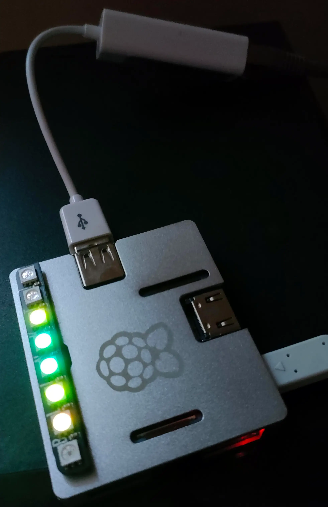
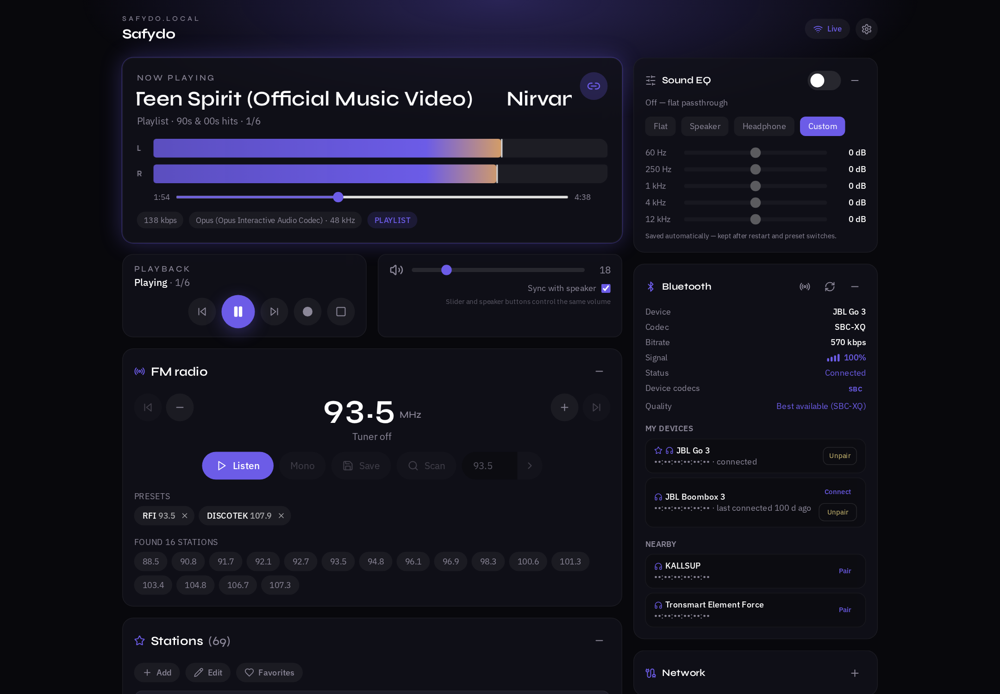
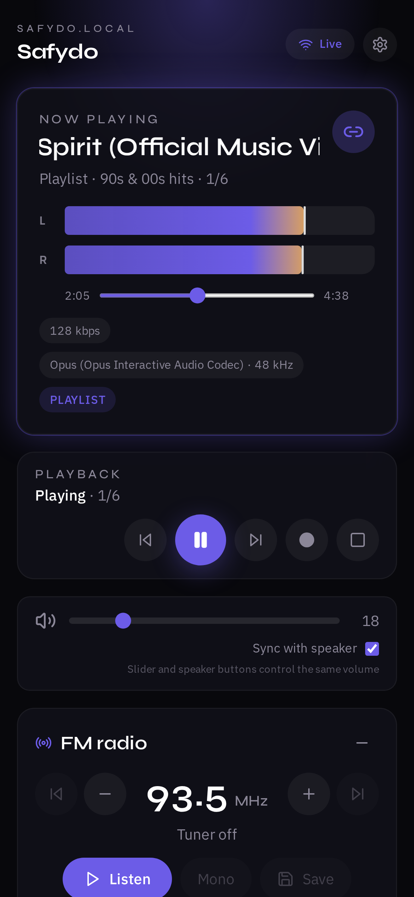
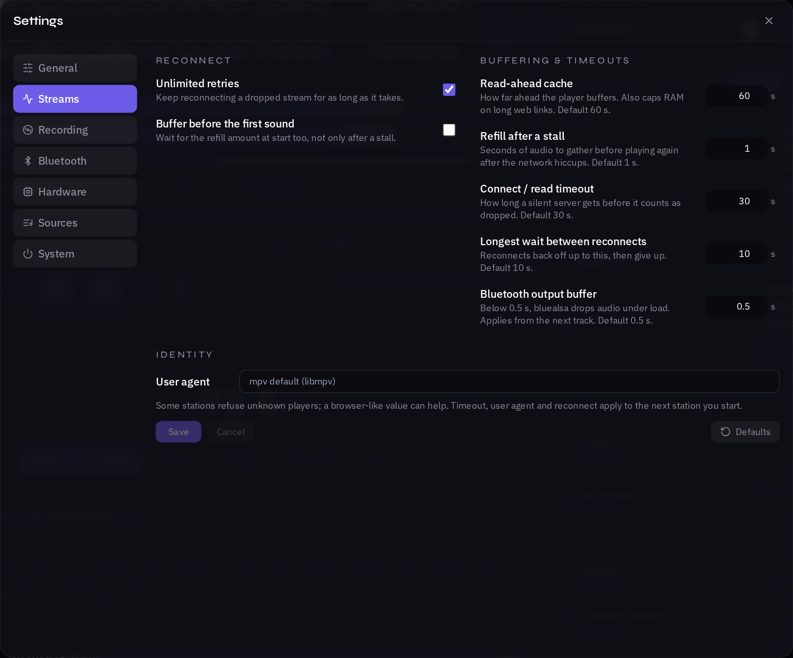
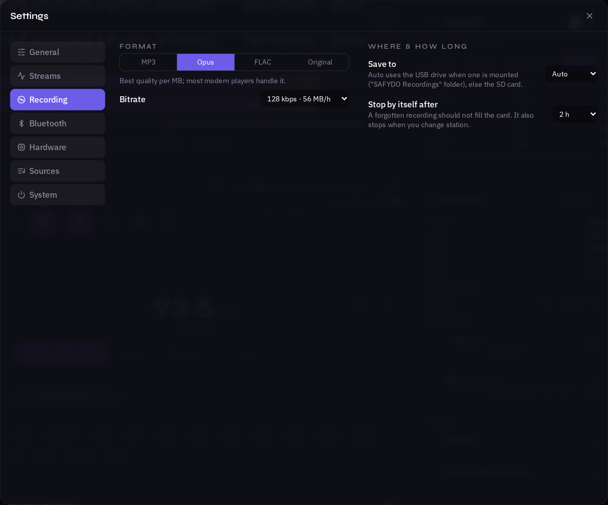

# SAFYDO — Raspberry Pi Bluetooth Audio Player

Turn a spare Raspberry Pi into a headless player for internet radio, FM, YouTube/SoundCloud-style
links and your own music, streaming to a Bluetooth speaker at the best codec the speaker supports.
Everything is controlled from a web UI — no screen, no keyboard, no app to install.

Built for 512 MB boards: about **170 MB in use while playing** a station, with under 10 % of the
CPU busy (Pi 3 A+, Trixie, measured November 2026). The live-rewind buffer adds what you allow it
in Settings.

<p align="center">
  
</p>

<p align="center">
  <em>A whole player: Pi, USB Ethernet dongle, music stick — and the optional Blinkt! LED strip acting as a live VU meter.</em>
</p>



<sub>[The whole page](docs/images/safydo-ui-full.png) — stations, web-link playlists, files and recordings below the fold.</sub>

<p align="center">
  
  &nbsp;
  
</p>
<p align="center">
  
</p>

- **Web UI only** — stations, playback, EQ, Bluetooth pairing, recording, network and shutdown at `http://safydo.local`
- **Best-quality Bluetooth** — bundles a source build of bluez-alsa with SBC-XQ, AAC, aptX, aptX-HD and LDAC, and picks the best codec the speaker offers
- **Internet radio + local files** — a bundled station list, thousands more via Radio Browser and Jamendo, plus USB sticks and SMB/NFS shares
- **Add a station by its website** — type `afc.fm` and SAFYDO finds the stream; logos are found for you (or upload your own, SVG included), favourites are a tap on the heart
- **Web links & playlists** — YouTube, SoundCloud, Mixcloud, Vimeo, Dailymotion and Rumble, audio only, in playlists with shuffle and loop
- **Live rewind** — scrub back up to 45 minutes on any live stream, then jump back with **LIVE**
- **Recording** — record a station, a live link or FM to MP3, Opus, FLAC or the untouched broadcast
- **FM radio** (optional board) — with full RDS/RBDS
- **Survives power loss** — logs on tmpfs, tuned ext4, minimal SD writes, settings files written atomically
- **Optional web login** — a username and password in front of the whole UI, off by default

---

## 1. Hardware you need

| | |
|---|---|
| **Board** | Raspberry Pi **Zero 2 W** or **Pi 3 Model A+** (both 512 MB) |
| **SD card** | 8 GB or larger |
| **Power** | A supply that can hold 5 V under load — 2.5 A recommended |
| **Speaker** | Any Bluetooth A2DP speaker or headphones |
| **Network** | A **USB Ethernet or WiFi dongle** — see the warning below |
| *Optional* | USB stick for local music and recordings; a [Pimoroni Blinkt!](https://shop.pimoroni.com/products/blinkt) for a physical LED VU meter; a [uGreen DABBoard](https://ugreen.eu/product/ugreen-dab-board/) for FM (Pi 3 A+) |

> **About the network dongle.** Both boards share one 2.4 GHz radio between WiFi and Bluetooth, and
> A2DP audio stutters when they compete. The installer therefore disables the onboard WiFi *once a
> USB uplink is already carrying the board* — it will never cut the link you are connected over. A
> USB Ethernet dongle gives the most reliable audio; a USB WiFi dongle also works. On a Pi 3 A+ note
> there is only **one USB-A port**, so a dongle and a music stick need a powered hub.

Other Pi models are not tested. The installer detects the board and refuses to apply tuning it does
not recognise, so it should be safe to try.

## 2. Flash the OS

Use [Raspberry Pi Imager](https://www.raspberrypi.com/software/) with **Raspberry Pi OS Lite,
32-bit**. Desktop images are not supported.

**Either release works on either board.** Bookworm and Trixie are both supported, on both the Zero
2 W and the 3 A+ — the installer detects the board and the OS release as two independent things and
tunes each separately. The board decides the hardware tuning (overclock fragment, USB gadget link,
whether the WiFi radio is dual-band); the OS decides the package handling (BlueZ and bluez-alsa
versions, whether `/tmp` is already tmpfs). Nothing depends on a particular pairing, so pick
whichever release you prefer — Trixie if you want the newer BlueZ, Bookworm if you want the
longer-settled base.

In Imager, open the settings (gear icon) **before writing** and set:

- a **username and password** — modern Pi OS creates *no* default account, and skipping this leaves
  a board that refuses every SSH password
- **Enable SSH**
- your **WiFi network**, so you can reach the board for the first install

## 3. Install

SSH in and run:

```bash
sudo apt update && sudo apt install -y git
git clone https://github.com/anducampu/SAFYDO.git
cd SAFYDO
sudo ./install.sh
sudo reboot
```

That is the whole install. It is idempotent — re-run it any time to update or repair a box.

> **It takes a while.** The Bluetooth HD-codec stack is compiled from source: budget roughly
> **30–45 minutes on a Zero 2 W** and **20–30 on a 3 A+**. The difference is CPU speed, not the OS —
> the AAC encoder has no package on Raspbian armhf on either release, so it is built either way.
> Everything else takes a few minutes. Use `--dry-run` first to see the plan without touching the
> system.

After the reboot, open **`http://safydo.local`** from any machine on the same network. If mDNS does
not resolve, use the board's IP address.

### Install options

```bash
sudo ./install.sh                       # full first-time setup
sudo ./install.sh --dry-run             # print every action, change nothing
sudo ./install.sh --update              # refresh packages and redeploy configs
sudo ./install.sh --no-upgrade          # skip the OS dist-upgrade
sudo ./install.sh --keep-onboard-wifi   # never touch the onboard radio
sudo ./install.sh --help                # all flags
```

Useful environment variables:

| Variable | Effect |
|---|---|
| `SAFYDO_HOSTNAME=name` | mDNS name. Optional — boards that collide now rename themselves (see §12) |
| `SAFYDO_KEEP_SERVICES="a b"` | Units the slimming pass must leave alone |
| `APPLY_OVERCLOCK=1` | Opt into the per-board overclock |
| `PURGE_PRINTING=1` | Remove printing packages instead of just masking them |

## 4. First run — pair a speaker

Everything below is in the web UI; no SSH needed.

1. Power on the speaker and put it in **pairing mode**.
2. Open `http://safydo.local` → **Bluetooth** → **Scan**. Classic speakers take 8–16 s to appear, so
   let the scan finish before assuming it failed.
3. Click your speaker → **Pair**. It becomes the default output and reconnects automatically at boot.
4. Pick a station and press play.

The Bluetooth panel shows the negotiated codec and bitrate, so you can confirm you are getting the
best your speaker supports.

> **If pairing does not survive a reboot** — the panel shows `Paired: yes` but `Bonded: no` — the
> stale key is on the *speaker*, not the Pi. Factory-reset the speaker and pair again. Retrying from
> the Pi will not fix it.

## 5. Finding stations

SAFYDO ships with a starter station list, and you can pull in thousands more from two built-in
directories. Both are **off by default** — enable them under **Settings → Sources**, and they appear
as extra tabs in the station browser.

**[Radio Browser](https://www.radio-browser.info/)** — a free, community-maintained directory of
public Icecast/Shoutcast stations. **No API key, no account.** Browse by genre tag, search by name,
or sort by popularity. SAFYDO rotates across several mirrors so one being down does not break
browsing, and it hides streams the directory has already flagged as broken.

**[Jamendo](https://www.jamendo.com/)** — Creative-Commons licensed music from independent artists,
free to stream. This one needs a free `client_id` from
[developer.jamendo.com](https://developer.jamendo.com/) — paste it into **Settings → Sources**. Browse
by genre; tracks stream as MP3.

Anything you find plays immediately, and one tap **saves it into your own station list** so it is
there next time.

### Your own station list

- **Add a station from its website.** In **Add station**, type the station's site (`afc.fm`,
  `radiozu.ro`) instead of a stream URL and press **Find**, or just press **Add station**. SAFYDO reads
  the page, its scripts and its web-player pages, falls back to Radio Browser, and keeps only
  addresses that actually answer as live audio. When a site has several streams you pick one
  (format and bitrate shown).
- **Logos** are looked up automatically when a station is added: the Radio Browser entry, then the
  station site's app icons, large icons and preview image. **Settings → Sources → Station logos**
  fills in the whole list (or re-checks it). Per station, the editor can search again, take an image
  URL, a pasted or uploaded file, or pasted SVG code. SVGs are cleaned of anything active (scripts,
  event handlers, external links) and served with a locked-down content policy.
- **Favourites**: tap the heart on any row. **Edit** with the Favourites filter on edits only the
  favourites, and saving puts them back in place without touching the rest.
- **Colours**: each station takes its first genre's colour, or one you pick in the editor. The
  whole UI's accent follows the station that is playing.
- **Check stations** (Settings → Sources) opens every station once and lists the ones that don't
  answer, with the reason (timeout, server not found, HTTP 404…), and, for each, Try, **Find
  replacement** (the station's website first, then Radio Browser by closest name), Hide or Delete.

Both providers are plain HTTP clients in `backend/sources/`, so adding another directory means
dropping in one more file.

## 6. Web links and playlists

The **Web links** panel plays the audio of pages from **YouTube, SoundCloud, Mixcloud, Vimeo,
Dailymotion and Rumble**. Paste a link and SAFYDO reads its title, length and thumbnail once; tap it
to play. Under the hood it is [yt-dlp](https://github.com/yt-dlp/yt-dlp) feeding mpv, audio only,
through the same Bluetooth path as everything else.

- **Playlists** — any number, any length. Reorder with the arrows (even while one is playing — the
  change applies at once without interrupting the current track), start from any entry, and turn
  on **shuffle** or **loop** per playlist. Platforms mix freely in one list.
- **Prev / next** appear in Playback whenever there is a queue, including a YouTube or SoundCloud
  playlist link.
- **Vimeo** now refuses anonymous playback. Export `cookies.txt` (Netscape format) from a browser
  where you are signed in — a "cookies.txt" browser extension does it — and upload it under
  **Web links → Accounts → Vimeo**. Only that site's cookies are kept; they stay on the Pi and are
  sent only to that site.
- **Rumble** blocks plain HTTP clients, so SAFYDO plays it with yt-dlp's browser impersonation.

yt-dlp lives in its own venv (`/opt/yt-dlp`) and updates itself weekly, because sites change and the
fixes ship as releases. Details and measurements: [`docs/web-links.md`](docs/web-links.md).

## 7. Live rewind and stream tuning

Every live stream — stations and live links — keeps a rewind buffer in RAM. **Now Playing** shows a
bar over it: drag back to hear what you missed, press **LIVE** to return. Choose how much under
**Settings → General → Live rewind** (off to 45 minutes). The size is measured from what the stream
really costs in memory, so the minutes you pick are the minutes you get, up to a 96 MB cap — the
Settings page tells you when the cap is shorter than asked.

**Settings → Streams** tunes how online streams behave on a flaky network: reconnect attempts
(unlimited by default), the longest wait between reconnects, the read-ahead cache, how much to
refill after a stall (and optionally before the first sound), the connect/read timeout, the user
agent some stations insist on, and the Bluetooth output buffer. Changes apply to the running player,
no restart.

## 8. Recording

Press **●** in Playback to record what is playing live — a station, a live web link (a YouTube live,
say) or FM. SAFYDO taps the stream it already receives (nothing is downloaded twice) and encodes it
live, so no large temporary file ever lands on the SD card. On-demand links and files cannot be
recorded: the player has already fetched them ahead of what you hear, so the button is greyed out.

- **Formats** (Settings → Recording): **MP3** (128–320 kbps), **Opus** (64–256 kbps), **FLAC**
  (lossless, level 0–8), or **Original** — the broadcast untouched, no re-encode.
- **Where**: the `SAFYDO Recordings` folder on a USB drive when one is mounted, otherwise the SD card.
- **Stops by itself** when you change source, after a time limit you choose (4 h by default), or
  when free space runs low. A recording cut short by a restart is kept, not lost.
- **Recordings** panel: play, download, rename, delete.

## 9. FM radio (optional)

With a uGreen DABBoard on the Pi 3 A+ header, the **FM radio** panel tunes, seeks and scans the band,
keeps presets, shows RDS/RBDS (station name, radio text, programme type) and signal quality, and
can force mono on a weak signal. FM goes through the same EQ, VU meter, volume and recording as
every other source. The board's vendor tools cannot be redistributed, so setup is a one-time
script — see [`docs/radio.md`](docs/radio.md). DAB+ is not offered yet.

## 10. What the installer changes

It modifies the OS, so it is worth knowing what it does. All of it is reversible and none of it is
hidden — read `install.sh`, or run `--dry-run`.

- **Upgrades the OS** on every run (`--no-upgrade` opts out)
- **Installs** bluez, mpv, ffmpeg, nginx, avahi, python3-fastapi/uvicorn/pydantic, ntfs-3g, exfatprogs, udisks2 and friends
- **Puts yt-dlp in a venv** at `/opt/yt-dlp` (with `curl_cffi` for Rumble), plus Node.js as YouTube's JavaScript runtime, and a weekly update timer
- **Builds bluez-alsa from source** into `/usr/local` for the HD codecs Debian's package omits
- **Disables background services** that cost RAM or wake the SD card: apt-daily timers, man-db, e2scrub, ModemManager, cloud-init, printing, the desktop-only `mpris-proxy` Bluetooth bridge, and the idle NFS helpers (`rpcbind` stays socket-activated for NFSv3 shares). All `disable`, never `mask`, so it stays reversible; exempt any unit with `SAFYDO_KEEP_SERVICES`
- **Tunes boot and kernel** — `gpu_mem=16`, network buffers, tmpfs for logs and `/tmp`. Fragments live in `docs/os-tuning/` so you can read exactly what is applied
- **Keeps swap in compressed RAM (zram), never on the SD card.** On Trixie it switches Raspberry Pi OS's swap from `zram+file`, which writes idle pages into a swap file on the card every day, to zram only. On Bookworm it replaces `dphys-swapfile`. `SWAP_POLICY=keep` leaves the image's setup alone
- **Runs mpv lean** — on jemalloc, so a long stream's cache goes back to the system when you change station (`MPV_JEMALLOC=0` opts out), with no terminal status line and no screen-only scripts
- **Disables the onboard WiFi** only under the safety rule in §1
- **Installs systemd units** for the backend, player, Bluetooth auto-connect and USB automount

## 11. Blinkt! LED VU meter (optional)

A [Pimoroni Blinkt!](https://shop.pimoroni.com/products/blinkt) — eight RGB LEDs on a 2x20 header —
turns the player into something you can read across a room. SAFYDO drives it as a **centre-out
stereo VU meter**: the middle LEDs light first and the bar grows outward with the music, green
through amber as it gets loud. That is the strip you can see lit in the photo above.

It presses straight onto the GPIO header — no soldering, no extra wiring, and it does not block the
USB or HDMI ports. SAFYDO uses GPIO 23/24 via `lgpio`, which the installer sets up for you.

It is **off by default**. Turn it on in the web UI under **Settings → Hardware**, where you can also
set brightness (1–100%). With no Blinkt! attached, nothing happens and nothing breaks. The Blinkt!
and the FM board share GPIO 23, so it is one or the other.

## 12. Configuration

`config/player.yaml` holds the runtime settings — volume, EQ, auto-reconnect strategy, stream
tuning, recording, LED toggle, station-source plugins. Almost all of it is editable from the UI's
**Settings** (General, Streams, Recording, Bluetooth, Hardware, Sources, System). Stations live in
`config/streams.json` and can be added, edited or bulk-replaced from the UI.

- **Rename the box** under Settings → General → Hostname. The name is checked (a–z, 0–9 and `-`,
  up to 63 characters) and refused if another device on the network already answers it; the page
  then lives at the new `name.local`.
- **Modules** under Settings → General switch off panels you do not use — Web links, Files,
  Recordings. None of them runs anything while idle, so this mostly tidies the page.
- **Web login** under Settings → System puts a username and password (HTTP basic auth, checked by
  nginx) in front of the page, its controls, the live status and the setup page. Turned on without a
  password it uses `safydo` / `safydo` and keeps warning until you change it; the password is stored
  only as a SHA-512 hash. Requests from the board itself are exempt. The page is plain HTTP, so this
  keeps people out but does not encrypt anything. Locked out? Over SSH:
  `sudo /opt/rpi-audio-player/scripts/web_auth.sh disable`
- **Settings → System** also shows CPU, temperature, RAM and disk use (read only while that tab is
  open). Your settings survive re-running the installer and every deploy.

### Swapping the network adapter

The uplink is always a USB dongle (the onboard radio is off so Bluetooth owns
2.4 GHz), so swapping ethernet for WiFi is a normal thing to do. Adapters are
hot-swappable and the box keeps itself tidy:

- **WiFi dongle in** — the WiFi radio is switched on and a saved network is joined
  automatically. Profiles are not tied to an adapter, so a network learned on one
  dongle works on the next.
- **WiFi dongle out** — with no wireless adapter left, the radio is switched off
  rather than left scanning for hardware that is gone.
- **Either way** — route metrics are re-evaluated, so wired still beats wireless
  whenever both are present.

If the box has **no uplink and no known network**, it raises its own setup access
point — **`Safydo`** at `192.168.4.1` — so you can join a new WiFi from a phone.
This is **on by default**, because on a fresh board it is the only way in without
a serial cable. It needs a wireless adapter to host the AP, so an ethernet-only
box never raises one. Disable it with `captive_portal_enabled: false` in
`config/player.yaml`, or start it by hand:

```bash
sudo /opt/rpi-audio-player/scripts/captive_portal.sh start
```

It waits for several consecutive checks before acting, so a slow DHCP lease or a
dongle still enumerating never triggers it, and it stands down by itself once a
real uplink appears.

The setup page **lists the networks it can see**, with signal strength and a lock
for secured ones, so you pick yours instead of typing its name from memory —
"Other network…" is still there for a hidden SSID. Picking an open network does
not ask for a password.

> The list is a snapshot taken **just before the AP started**, and the page says
> so. A board with one radio cannot broadcast the setup network and scan for other
> networks at the same time, so refreshing while the AP is up re-reads that
> snapshot rather than sweeping again. If a network you expect is missing, it was
> not on the air at that moment — type it in.

> The setup AP is **open** (no passphrase), like most first-run provisioning
> networks — you cannot type a password into a box you have not configured yet.
> It exists only while the board has no uplink, and anyone joining it reaches the
> setup page, so bring the board online rather than leaving it advertising.

> **On radio interference.** Bluetooth on these boards is wired to the UART, not
> USB, so a USB WiFi dongle does not compete with audio for USB bandwidth. What
> can still bite is 2.4 GHz coexistence — much weaker than the onboard radio,
> which shared a die and an antenna with Bluetooth, but not zero. A **5 GHz-capable
> dongle avoids the question entirely** and is the one to buy if you plan to run
> on WiFi. Wired remains the most reliable.

### Running more than one board

Two SAFYDO boxes on one network would both want `safydo.local`. Rather than letting avahi break the
tie with a counter — which assigns `safydo-2.local` in whatever order the boards happen to boot, so
the same box changes name between reboots — a newly connected box detects that the name is taken and
claims one derived from its own address instead:

```
first box   ->  safydo.local
second box  ->  safydo-119.local     (10.0.0.119)
```

The suffix is the last octet of the box's own IP, which is unique within a subnet, so two boards can
never pick the same name. This runs at boot, and only when a conflict is actually detected — a box
alone on the network always keeps the plain name. A name you chose yourself — in Settings → General,
or `SAFYDO_HOSTNAME=kitchen` at install — is never overridden.

Check what a box thinks at any time:

```bash
sudo /opt/rpi-audio-player/scripts/hostname_conflict.sh status
```

> **The DHCP caveat.** The suffix follows the IP, so if the lease changes, the name changes with it.
> For a box you want to bookmark, give it a **DHCP reservation** on your router, or name it explicitly
> with `SAFYDO_HOSTNAME=` at install time. The automatic suffix is there to stop collisions, not to be
> a stable address.

The UI has **no authentication** — it assumes a trusted home LAN, and it binds to the LAN rather than
the internet. **Do not port-forward it.**

There is an optional token guard on mutating endpoints, but it is **inert until you enable it**: the
backend only checks `X-Safydo-Token` when `PLAYER_API_TOKEN` is set in its environment. Sending the
header without that is not protection. To turn it on:

```bash
sudo systemctl edit audio-player-backend    # [Service] Environment=PLAYER_API_TOKEN=<secret>
sudo systemctl restart audio-player-backend
```

Until then every mutating endpoint — including shutdown and Bluetooth pairing — is open to anyone on
the network.

## 13. Development

The Pi has no Node toolchain — a 512 MB board cannot run a Vite build — so **`frontend/dist/` is
committed** and a clone installs a ready-built UI. Rebuild it on a dev machine:

```bash
cd frontend && npm install && npm run build
```

Deploy a working tree to a running board:

```bash
PI_HOST=<pi-ip> ./scripts/deploy.sh --build
```

A deploy that interrupts playback starts the same station, link, playlist or FM frequency again
when it finishes. A paused or stopped player is left alone.

Live UI development against a real board:

```bash
SAFYDO_DEV_HOST=<pi-ip> npm run dev
```

## 14. Troubleshooting

| Symptom | Start here |
|---|---|
| Install finished but the UI is blank | Re-run the installer; it prints `INSTALL INCOMPLETE` and what is missing |
| No sound, "no Bluetooth speaker connected" | Speaker off or unpaired — pair it in the UI |
| Pairing lost on every reboot | Factory-reset the speaker (see §4) |
| Audio stutters | You are probably on the onboard 2.4 GHz WiFi — add a USB dongle |
| Locked out after WiFi was disabled | `sudo scripts/wifi_onboard.sh enable`, or the recovery routes in `docs/usb-dev-link.md` |
| Forgot the web login | Over SSH: `sudo /opt/rpi-audio-player/scripts/web_auth.sh disable` |
| Music stops, Bluetooth "connected" but silent | The onboard Bluetooth controller stopped answering (see Known limitations). Only a reboot recovers it; the BT watchdog can do that for you (Settings → Bluetooth) |

On-device diagnostics: `sudo /opt/rpi-audio-player/scripts/diag.sh`

More detail lives in `docs/` — `phase0.md` through `phase7.md` cover each subsystem, and
`porting-pi3aplus.md` documents the board and OS differences.

## 15. Status

Feature-complete and running on both supported boards: Bluetooth pairing with HD codec selection,
internet radio, web links with playlists, live rewind, recording, FM radio with RDS, USB and
network-share playback, EQ with presets, a live stereo VU meter, a captive portal for WiFi setup,
USB automount and safe shutdown. The newest features were verified on the Pi 3 A+ (Trixie); the
Zero 2 W (Bookworm) path is built for — older mpv and ffmpeg are handled — but not yet re-tested.

Known limitations:

- Some speakers advertise **SBC only** — SAFYDO then negotiates SBC-XQ (~570 kbps), which is the best
  that hardware can do
- The WiFi setup hotspot needs a **USB WiFi dongle**: the onboard radio is kept for Bluetooth only.
  With no dongle there is no hotspot, and the box is expected to be on ethernet
- **The onboard Bluetooth controller can stop answering** after long A2DP sessions (`hardware error
  0x00` / `command tx timeout` in the kernel log), on more than one Pi model and on every kernel,
  BlueZ and audio stack tried, including other people's
  ([bluez/bluez#937](https://github.com/bluez/bluez/issues/937)). There is no upstream fix. SAFYDO
  keeps the controller's work low while streaming and can reboot itself to recover (at most 3 times
  a day). A USB Bluetooth dongle avoids it entirely. An experiment you can try:
  `sudo scripts/bt_uart_speed.sh set 2400000` slows the Pi-to-chip serial link (no effect on sound
  quality) and takes effect after a reboot. `reset` undoes it. On the 3 A+ the first run lasted
  nearly 4 hours against 20 minutes to 2 hours before, then failed anyway: too early to call
- AAC is denylisted for a few devices whose firmware stalls when switching codecs
- Web-link sites change without notice; when one breaks, the weekly yt-dlp update usually fixes it.
  Vimeo needs your account cookies, which expire when you log out in the browser
- On Bookworm, ffmpeg 5.1 cannot cap reconnect attempts (always unlimited), and its Node.js 18 is
  older than yt-dlp wants for YouTube — YouTube may stop working there before it does on Trixie

## License

GPLv3 — see [LICENSE](LICENSE). Contributions welcome.
